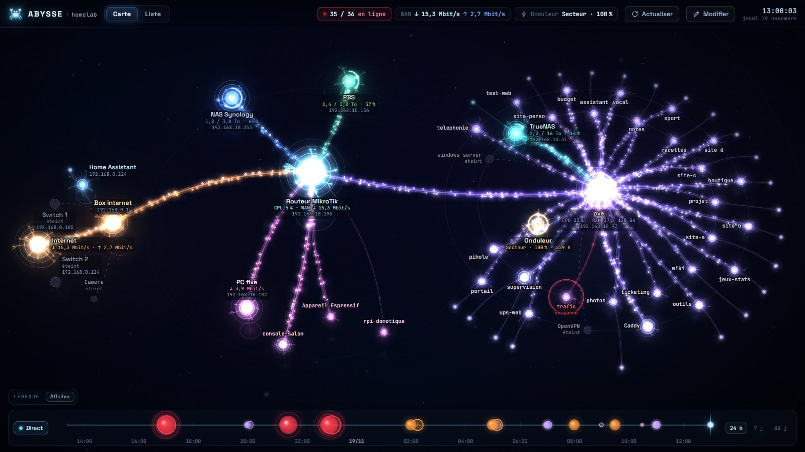
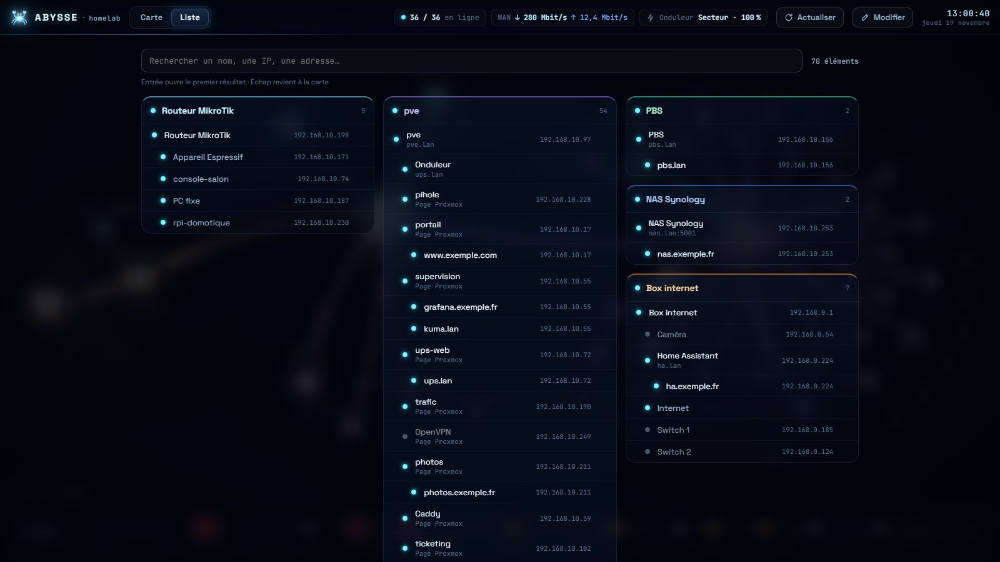

# Abysse

Une carte vivante de mon homelab. Chaque machine est un point lumineux, les câbles
montrent le débit en direct, et une frise garde ce qui s'est passé sur 30 jours.



Abysse lit le routeur MikroTik, Proxmox VE, l'onduleur (NUT), InfluxDB et TrueNAS, en
lecture seule, et dessine le tout dans le navigateur. Le serveur est en Python avec
uniquement la bibliothèque standard, et la page web n'a aucune dépendance : pas de
framework, pas de CDN, rien à compiler.

## Ce qu'on voit

- le routeur au centre, les machines autour, une couleur par groupe (Proxmox,
  sauvegardes, NAS, box, domotique...)
- les CT et les VM de Proxmox, trouvés tout seuls, avec CPU, RAM et disque
- les sites servis par Caddy, accrochés au CT qui les sert
- les appareils du réseau local vus par le MikroTik (ARP, DHCP), avec le fabricant
  deviné par l'adresse MAC
- le débit de chaque câble, dessiné par des particules, et le débit WAN en haut
- l'onduleur : quand il passe sur batterie, toute la carte vire à l'ambre avec
  l'autonomie restante
- une frise du temps (24 h, 7 jours, 30 jours) avec les pannes, les retours et les
  coupures de courant, et on peut revoir la carte à n'importe quel moment passé
- un onglet Liste avec une recherche par nom, IP ou adresse
- un mode Modifier pour renommer, cacher, marquer un équipement « éteint exprès » ou
  ajouter des liens à la main
- ça marche sur téléphone, et le réglage « réduire les animations » du système est
  respecté



## Essayer en deux minutes

Il faut Python 3.12 ou plus récent (Debian 13 fournit la 3.13), rien d'autre.

```
git clone https://github.com/tom-lion38/abysse
cd abysse
python3 -m abysse --demo --port 8080
```

Puis ouvrir http://localhost:8080. Le mode démo invente un homelab complet avec un
scénario qui tourne en boucle : pointe de trafic, CT qui s'arrête, coupure de courant,
appareil qui part et revient. Il remplit aussi 24 h d'historique pour la frise.

## Installation sur un vrai homelab

Tout est dans [docs/INSTALLATION.md](docs/INSTALLATION.md) : création du CT, accès en
lecture seule pour chaque source, inventaire, pare-feu, mises à jour.

## Comment c'est fait

```
abysse/
  sources/      un module par source (MikroTik, Proxmox, NUT, InfluxDB, TrueNAS)
  collecteur.py interroge chaque source à son rythme, dans son propre thread
  modele.py     transforme les lectures en un « instantané » JSON (nœuds et liens)
  evenements.py compare deux instantanés et en tire les évènements de la frise
  historique.py SQLite : instantanés compressés et évènements, gardés 30 jours
  serveur.py    serveur HTTP : fichiers, API JSON, flux SSE
  inventaire.py équipements fixes, remplaçables par un fichier JSON
web/            une seule page, rendu sur canvas en perspective, aucun appel extérieur
deploy/         création du CT, installation, service systemd, pare-feu
tests/          tests Python (unittest) avec des fixtures anonymisées
```

Le serveur pousse un instantané par seconde au navigateur par SSE (`/api/flux`). Le
navigateur garde la disposition stable : un CT qui s'arrête change de couleur mais ne
fait pas bouger la carte.

| Source | Ce qui est lu | Rythme |
| :-- | :-- | :-- |
| MikroTik (API REST) | interfaces et débits | 2 s |
| MikroTik (API REST) | ressources, ARP, baux DHCP, table du pont | 30 s |
| Proxmox VE (API) | invités, état, CPU, RAM, réseau, état du nœud | 2 s |
| Proxmox VE (API) | configuration des invités (IP, démarrage auto) | 5 min |
| NUT | batterie, autonomie, tension, état | 2 s |
| InfluxDB 2 | sondes Uptime Kuma, Synology, pool du PBS | 30 s |
| TrueNAS (JSON-RPC) | état et place des pools | 2 min |
| Phare (facultatif) | liste des sites de Caddy | 10 min |

Chaque source est facultative : une source non configurée est ignorée, une source qui
ne répond plus passe en « inconnu » (gris bleuté), jamais en rouge. Le rouge est gardé
pour les vraies pannes. Seul le routeur doit figurer dans l'inventaire, parce que c'est
le centre de la carte.

## Sécurité

- Abysse n'a pas de compte ni de mot de passe : il est fait pour le réseau local et le
  VPN, jamais pour internet. Un fichier nftables est fourni pour le CT.
- Tous les accès aux sources sont en lecture seule (rôle PVEAuditor, jeton InfluxDB en
  lecture, utilisateur MikroTik en lecture, utilisateur TrueNAS en lecture seule).
- Les secrets restent dans `/etc/abysse/abysse.env` (droits 600) et ne sortent jamais
  par l'API ni dans les journaux.
- La clé TrueNAS ne circule pas : l'authentification se fait par SCRAM-SHA-512, liée
  au certificat du serveur.
- Toutes les saisies du mode Modifier sont vérifiées côté serveur, et la page a une
  CSP stricte.

## Tests

```
python3 -m unittest discover -s tests
node --test web/tests/
```

Les tests Python lancent de faux serveurs locaux pour chaque source. Les tests web
tournent avec Node 22 ou plus récent, sans dépendance.

## Licence

Le code est sous licence MIT (voir [LICENSE](LICENSE)). Les polices JetBrains Mono et
Space Grotesk, dans `web/polices/`, sont sous SIL Open Font License 1.1 (voir
[web/polices/LISEZ-MOI.md](web/polices/LISEZ-MOI.md)).
